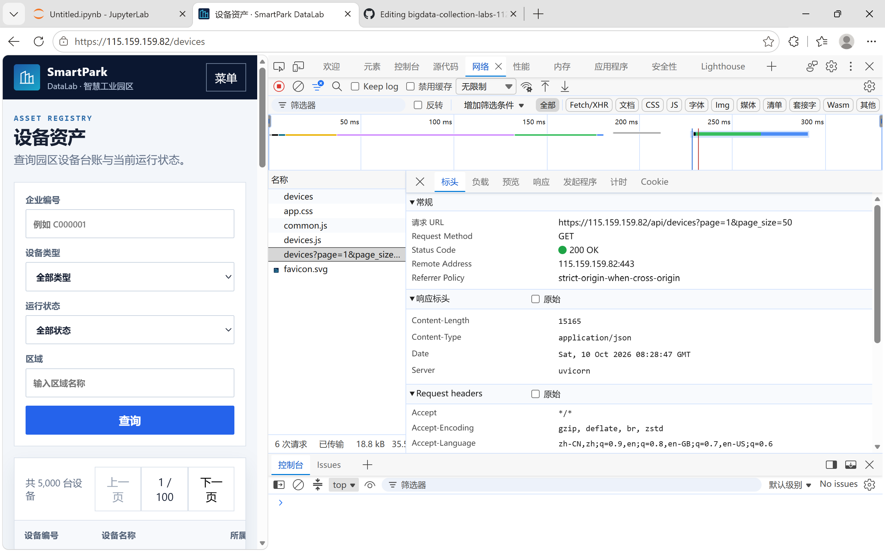
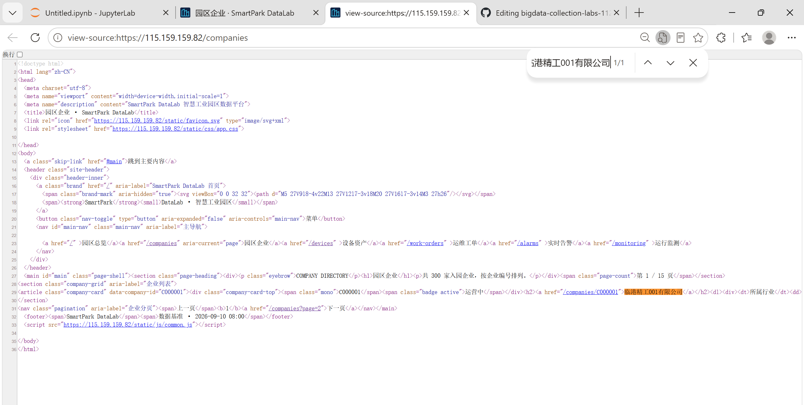
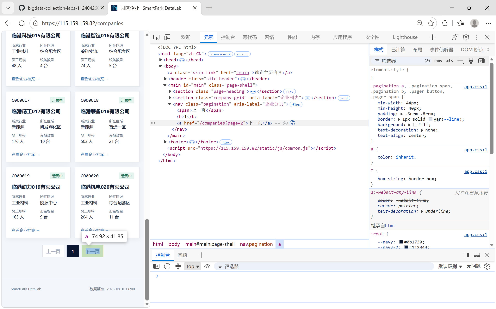
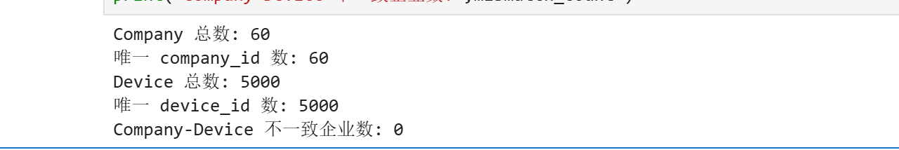

# Lab 1 实验报告

## 学生信息

- **姓名：陈俊宏**
- **学号：112404260127**
- **班级：数据1241**
- **GitHub 用户名：Crimson06-22**
- **仓库地址：https://github.com/Crimson06-22/bigdata-collection-labs-112404260127**

> 文件位置：`lab01/REPORT.md`  
> 完整代码保存在 `lab1_html_api.ipynb`。  
> 本报告只填写关键发现、关键代码、结果和指定截图，**不要把整份 Notebook 复制进来**。

---

# 任务 1：判断数据加载方式

## 1.1 Device：判断动态加载并找到 API

### 判断结果

- 页面：`/devices`
- 数据加载方式：`动态加载`
- 判断依据：

请用 1～2 句话说明：

1. 在“查看网页源代码”中无法搜索到页面上的设备名称；
2. 在 Network 的 Fetch/XHR 中能找到返回设备数据的请求。

### API 信息

- Request URL：https://115.159.159.82/api/devices?page=1&page_size=50
- Request Method：
- Query 参数：

### 【截图 1】Device API 发现证据

文件名：

```text
images/01_device_api.png
```

**截图内容必须是浏览器 DevTools，不是 Jupyter 代码。**

截图中应能看清：

1. 浏览器的 **Network** 面板；
2. 已选中真正返回设备列表的 Fetch/XHR 请求；
3. 右侧 **Headers** 中的 Request URL；
4. Query String Parameters（或 URL 中的分页参数）。

> 不要截整个桌面；尽量裁剪到 Network 请求和右侧 Headers 区域。

插入：

```markdown

```

---

## 1.2 Company：判断静态加载

- 页面：`/companies`
- 数据加载方式：`静态加载 / 动态加载`
- 判断依据：

请说明：使用“右键 → 查看网页源代码”后，是否能搜索到页面中真实显示的企业名称。

### 【截图 2】Company 静态加载证据

文件名：

```text
images/02_company_source.png
```

**截图内容必须是“查看网页源代码”页面，不是 Elements，也不是 Jupyter。**

截图中应能看清：

1. 浏览器正在显示 `/companies` 的网页源代码；
2. 使用 `Ctrl + F` 搜索一个页面中真实存在的企业名称；
3. 源代码中能看到该企业名称或对应企业记录。

插入：

```markdown

```

---

# 任务 2：Device API 分页采集

## 2.1 API 分页结构

填写你实际从 JSON 中观察到的字段：

| 含义   | JSON 字段 |
| ---- | ------- |
| 当前页  |         |
| 每页条数 |         |
| 设备总数 |         |
| 设备列表 |         |

---

## 2.2 关键代码

只填写分页采集的核心部分，不要粘贴整个 Notebook。

```python
# 从第一页响应中读取分页信息
total = data["________________"]
page_size = data["________________"]

total_pages = ______________________________________

devices = []

for page in range(1, total_pages + 1):
    r = requests.get(
        api_url,
        params={
            "________": page,
            "________": page_size
        },
        timeout=10
    )

    page_data = r.json()
    page_items = page_data["________________"]
    ________________________________________________
```

---

## 2.3 采集结果

- 每页条数：
- 设备总数：
- 程序计算得到的总页数：
- 最终采集设备数：
- 唯一 `device_id` 数：

回答：

> 为什么总页数应由 API 返回的 `total` 和 `page_size` 计算，而不是直接在代码里写死？

答：

---

# 任务 3：Company HTML 解析

## 3.1 企业记录 Selector

- 企业记录 selector：
- 第 1 页企业记录数：

说明为什么选择这个 selector：

- 主要使用了 `id / class / data-* / 父子层级` 中的哪一种？
- 是否参考过浏览器 Copy selector 或 AI？
- 最终为什么采用现在这个写法？

答：

---

## 3.2 关键代码

只填写“记录定位 + 一条记录的关键字段”。

```python
cards = soup.select("________________________________")

card = cards[0]

company_id = ______________________________________
name = ____________________________________________
status = __________________________________________
```

行业、区域、设备数量使用 `dt/dd` 结构后，请写出你最终如何得到：

```python
industry = ________________________________________
zone = ____________________________________________
device_count = ____________________________________
```

---

## 3.3 字段来源说明

任选 **2 个字段**说明：

1. 字段：
   - 来自：`文本 / HTML 属性`
   - 使用的方法：
2. 字段：
   - 来自：`文本 / HTML 属性`
   - 使用的方法：

---

# 任务 4：Company “下一页”分页

## 4.1 下一页元素

- “下一页” selector：
- 第 1 页 `href` 示例：

### 【截图 3】Company “下一页”元素

文件名：

```text
images/03_company_next.png
```

**截图内容必须是浏览器 DevTools 的 Elements 面板。**

截图中应能看清：

1. 页面底部“下一页”对应的 `<a>` 元素被选中；
2. 该元素的 `class`、`href` 等关键属性；
3. 能判断你为什么使用当前 selector。

> 不需要截 Python 代码；这一张图只证明你找到了正确的 DOM 元素。

插入：

```markdown

```

---

## 4.2 关键代码

```python
next_link = soup.select_one("____________________________")

next_href = ________________________________________

next_url = urljoin(
    current_url,
    ________________________________________________
)
```

再用 2～3 句话说明：

> 你的程序如何完成“当前页 → 找下一页 href → 请求下一页 → 再解析”的循环？

答：

---

## 4.3 三页采集结果

| 页码     | 企业数 |
| ------ | --: |
| 1      |     |
| 2      |     |
| 3      |     |
| **合计** |     |

- 唯一 `company_id` 数：

---

# 任务 5：结果验证

## 5.1 最终结果

| 检查项                   | 结果 |
| --------------------- | -: |
| Company 总数            |    |
| 唯一 `company_id`       |    |
| Device 总数             |    |
| 唯一 `device_id`        |    |
| Company–Device 不一致企业数 |    |

### 【截图 4】最终验证结果

文件名：

```text
images/04_validation.png
```

**截图内容必须是 JupyterLab 的运行结果，不是代码截图，也不是浏览器截图。**

截图中应能同时看清以下输出：

```text
Company 总数
唯一 company_id 数
Device 总数
唯一 device_id 数
Company–Device 不一致企业数
```

建议把这几个 `print()` 放在同一个 Notebook 单元格中运行后截图。

插入：

```markdown

```

---

## 5.2 一致性检查关键代码

只填写最关键的比较逻辑：

```python
from collections import Counter

device_counts = Counter(
    x["company_id"] for x in devices
)

mismatch_count = 0

for company in companies:
    cid = __________________________________________
    expected = _____________________________________
    actual = _______________________________________

    if _____________________________________________:
        mismatch_count += 1
```

回答：

> 为什么 `status_code == 200` 仍然不能说明“数据已经采集正确”？

答：

---

# 任务 6：保存采集结果

确认已经生成：

```text
data/companies.json
data/devices.json
```

填写：

- `companies.json`：`已生成 / 未生成`
- `devices.json`：`已生成 / 未生成`

不需要截图 JSON 全文，也不需要把 JSON 内容复制到报告。

---

# 实验结论

用 **80～150 字**总结：

1. 静态加载与动态加载页面的处理方式有什么不同；
2. HTML “下一页”分页和 API `page` 分页有什么不同；
3. 你使用了哪些方法验证采集结果。

答：
